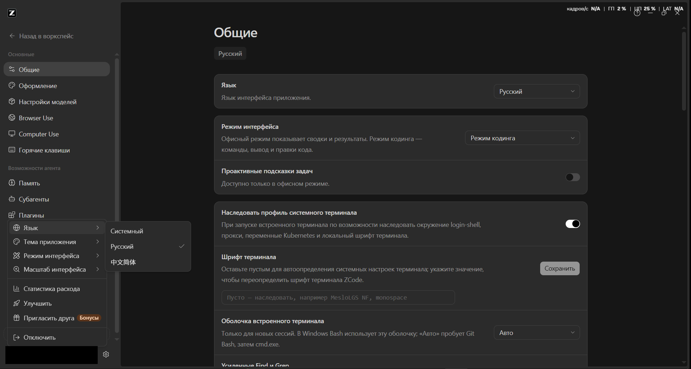

# ZCode Russifier — русификатор ZCode Desktop

**Русский | [English](README.en.md)**

[](https://github.com/xISPx/zcode-russifier/releases)
[](https://github.com/xISPx/zcode-russifier)
[](https://nodejs.org/)
[](LICENSE)
[](https://zcode.z.ai)

Неофициальный русификатор [ZCode Desktop](https://zcode.z.ai) (десктопное приложение ZCode для Windows). До версии 3.18 приложение поддерживало только английский и китайский — скрипт добавлял русский, переписывая строки внутри `app.asar`. Начиная с 3.18 в ZCode есть **официальный русский язык**: скрипт переключается в режим дополнения и переводит только то, что официальный перевод не охватывает, — нативные меню (трей, заголовочное), диалоги главного процесса (обновления, «О программе»), карточки шаблонов автоматизаций и попапы акций.

> **EN summary:** unofficial russifier for ZCode Desktop (Windows). Since ZCode 3.18 ships an official Russian locale, the script works in supplement mode: it patches only what the official locale misses — native menus, main-process dialogs, automation template cards and campaign popups. For ZCode below 3.18 it still translates the whole UI (6974 strings, 100%). Requires Node.js 18+: `node russify.js`. Rollback: update or reinstall ZCode.



**ZCode 3.18+ (текущий режим — дополнение):** сам интерфейс переводится официально и включается в **Настройках → Язык → «Русский»**; скрипт патчит нативные меню (49/50 пунктов), диалоги главного процесса (32/32 заготовки), карточки шаблонов автоматизаций и серверные попапы акций. **ZCode до 3.18 (полный режим):** переведено 6974 из 6974 строк каталога интерфейса (v3.16.2) — 100% покрытие. Что покрывал полный режим:

- боковая панель, список задач и группы;
- чат: поле ввода, действия с сообщениями, приветствия, карточки предпросмотра;
- меню приложения, командный центр и палитра команд;
- режимы агента (План, Автоправки, Полный доступ и т.д.);
- **настройки целиком**: модели и провайдеры, MCP-серверы, Coding Plan и оплата, навыки, субагенты, плагины, команды, хуки, браузер, память, индексация, Computer Use;
- автоматизации (задачи по расписанию) и задачи простоя;
- мобильное удалённое управление, страница ботов (Telegram / Weixin / Feishu / вебхуки);
- карточки шаблонов автоматизаций и задач простоя (Standup Git Summary, Risk scan, Release brief и др. — приходят с сервера, русифицируются через словарь по заголовку и началу описания);
- SSH- и WSL-подключение, нативное меню, меню «открыть в…» (Проводник / VS Code), диалоги обновлений и «О программе».

Намеренно **не** переводятся только строки, которые отправляются модели (описания навыков, служебные промпты агента), чтобы не влиять на качество работы ИИ. Названия тарифов переведены (Лайт / Про / Макс), названия сервисов и каналов (Telegram, Feishu и т.п.) остались латиницей.
> ⚠️ **Важно**
> - Русификатор — это модификация файлов приложения. Делаете на свой страх и риск.
> - **Автообновление ZCode затирает русификацию.** После каждого обновления просто запустите скрипт ещё раз.
> - Откат в любой момент: обновите или переустановите ZCode — установщик сам вернёт оригинальный `app.asar`.
> - Проверено на версиях **3.11.2, 3.12.3, 3.14.0–3.14.5, 3.15.1, 3.15.3, 3.16.2, 3.18.2 (Windows x64)**. Скрипт ищет нужные чанки по маскам, поэтому часто подходит и для соседних версий; при существенных изменениях структуры он сообщит об этом.
> - В ZCode 3.18+ не забудьте включить официальный русский: **Настройки → Язык → «Русский»** — скрипт его не включает за вас.

---

## Требования

- Windows
- [Node.js](https://nodejs.org/) 18 или новее (`node -v` — чтобы проверить)
- Установленный ZCode Desktop

## Установка русского языка

Требуется [Node.js](https://nodejs.org/) 18+ (`node -v` — проверить). Скачайте репозиторий (кнопка **Code → Download ZIP**, распакуйте) или склонируйте:

```
git clone https://github.com/xISPx/zcode-russifier.git
cd zcode-russifier
```

Затем одна команда:

```
node russify.js
```

Скрипт сам найдёт ZCode в `%LOCALAPPDATA%\Programs\ZCode`, пропатчит `app.asar` и напечатает отчёт. Перезапустите ZCode — интерфейс станет русским.

Если ZCode установлен в нестандартное место, укажите путь вторым аргументом:

```
node russify.js "D:\Programs\ZCode"
```

Закрывать ZCode перед запуском **не обязательно**: скрипт умеет перезаписывать архив поверх работающего приложения (русский появится после перезапуска).

В Windows можно просто дважды щёлкнуть `run.cmd` — он делает то же самое, что и `node russify.js` (нужен Node в PATH).

### Установщик .exe (для своих сборок)

Готовый .exe не распространяется. При желании его можно собрать самому по рецепту `installer/russifier.sed` — пакет собирается встроенным в Windows IExpress и включает свой `node.exe`, поэтому готовый установщик работает на машине без Node:

```
iexpress /N installer\russifier.sed
```

## Как это работает

В приложении два базовых языка интерфейса — `en-US` и `zh-CN` — и жёсткая логика «системный язык начинается на zh → китайский, иначе английский». Отдельного файла локали нет, строки вкомпилированы в минифицированный код. Поэтому русификатор:

1. разбирает заголовок `app.asar` и находит нужные чанки: карту нативного меню, диалоги главного процесса, чанк стилей рендерера (а в полном режиме — ещё и каталог строк рендерера `IntlProvider-*.js`);
2. заменяет значения на русские из папки `translations` (плейсхолдеры вида `{count}` проверяются — перевод с несовпадающими подстановками отбрасывается);
3. пересчитывает контрольные суммы SHA-256 изменённых файлов и дописывает их в конец архива, сохраняя позиции всех остальных файлов;
4. подменяет `app.asar` (если приложение держит файл — перезаписывает поверх, старая разметка остаётся совместимой). Если заголовок архива вырос сверх исходной зоны (так случилось в 3.15.3), скрипт выполняет полную пересборку архива — для этого ZCode должен быть закрыт, иначе скрипт сообщит об этом.

В режиме дополнения (ZCode 3.18+) каталог рендерера не трогается вообще — официальный перевод живёт в собственном оверлее над английской базой и включается настройкой языка.

Настройку языка в приложении менять не нужно: русифицируется именно английская локаль, она и включена по умолчанию.

## Откат

Любой из способов:

- обновить ZCode (Справка → Проверить обновления) — установщик восстановит оригинальный архив;
- переустановить ZCode.

## После обновления ZCode

Русификация слетит — это нормально. Скачайте актуальную версию репозитория и снова выполните `node russify.js`. В ZCode 3.18+ убедитесь, что включён официальный русский (**Настройки → Язык → «Русский»**). Если разработчики существенно изменят внутреннюю структуру приложения, скрипт сообщит «не найден чанк…» — тогда потребуется обновление самого русификатора (следите за issues).

## Структура репозитория

```
russify.js           — скрипт русификации (запускать его)
run.cmd              — то же самое двойным щелчком (нужен Node в PATH)
translations/        — словари перевода (JSON: ключ → русская строка)
installer/           — рецепт сборки setup-.exe (IExpress)
screenshots/         — иллюстрации для README
```

Словари можно пополнять: возьмите недостающий ключ из каталога (скрипт печатает общее число строк) и добавьте `"ключ": "перевод"` в любой JSON из `translations/`. Переводится только интерфейс; строки для модели сознательно оставлены английскими.

## Частые проблемы

- **«Не найден app.asar»** — ZCode установлен в другое место, передайте путь аргументом.
- **«Контрольные суммы не совпали»** — версия приложения сильно отличается; заведите issue.
- **После запуска ничего не изменилось** — перезапустите ZCode полностью (иконка в трее → Выйти, затем запустить).
- **Часть строк осталась английской** — в ZCode 3.18+ это строки, которые официальный русский ещё не перевел (~4–5% каталога, Z.ai доделывает их в новых версиях); меню и диалоги закрывает наш скрипт. В полном режиме (до 3.18) по-английски остаются только служебные строки для модели (описания навыков, системные промпты): их перевод снижает качество работы ИИ. Названия тарифов (Лайт, Про, Макс) переведены. Функции, добавленные разработчиками после релиза русификатора, появляются на английском до обновления словарей.

## Лицензия

[MIT](LICENSE). ZCode является товарным знаком своих владельцев; проект не связан с разработчиками ZCode.
